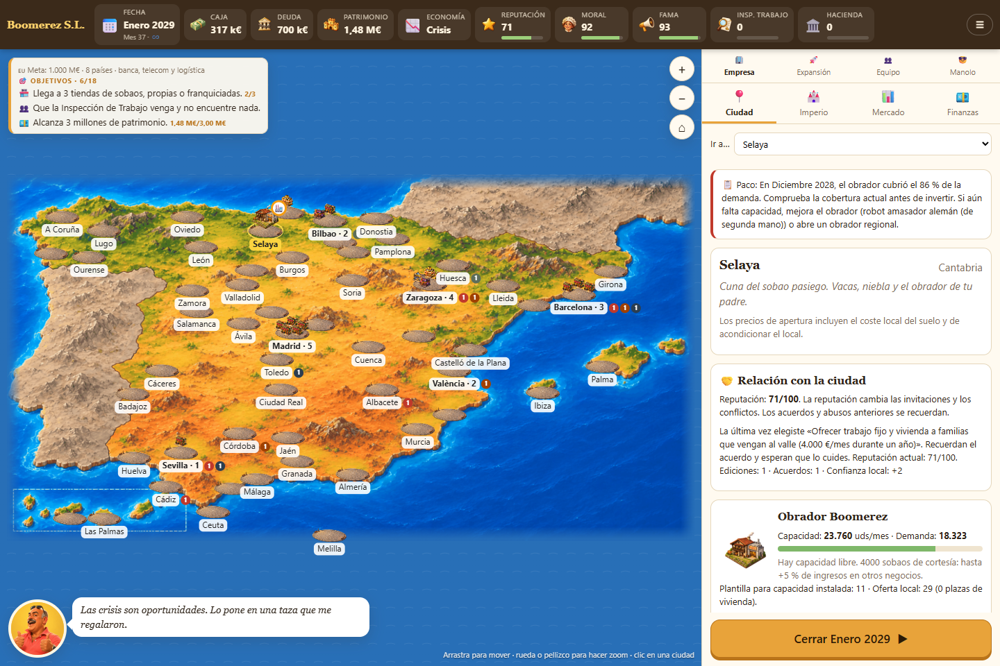
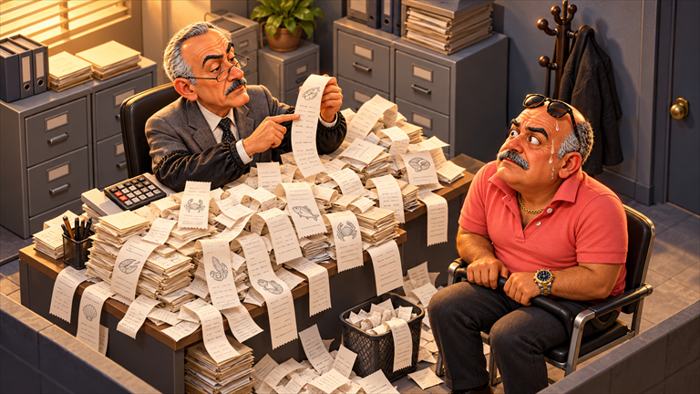
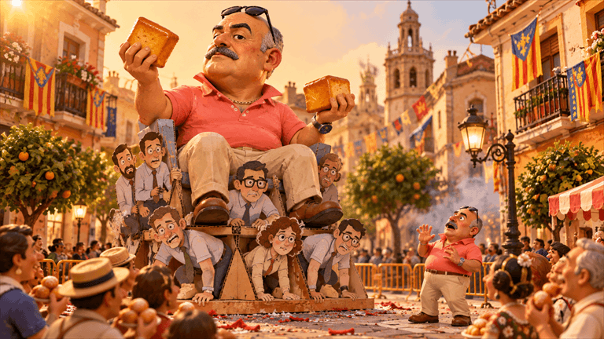
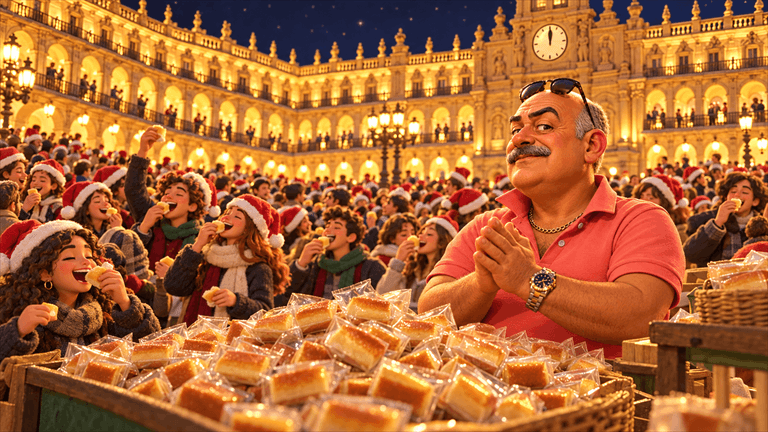
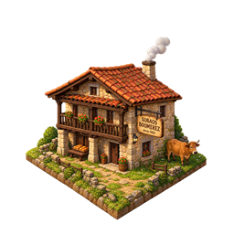
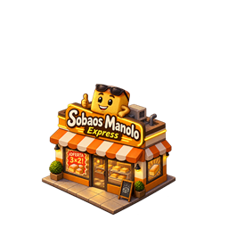
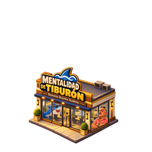
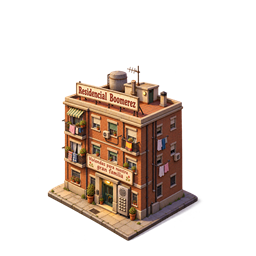

# Manolo Boomerez S.L.

> Sobaos, ladrillo y mentalidad de tiburón.

## [▶ JUGAR AHORA](https://javieratomic.github.io/manolo-boomerez/)

**Gratis, en PC o móvil. Sin instalar nada ni crear una cuenta.** Pulsa «Nueva partida», elige dificultad y marca, y empieza a decidir.

[⬇ Descargar para Windows](https://github.com/javieratomic/manolo-boomerez/releases/download/v0.21.6/ManoloBoomerez-0.21.6-portable.exe) — portable: descargar y abrir, sin instalación.

Una sátira de gestión por turnos: heredas un obrador en Selaya y sueñas con construir el mayor imperio económico de Europa. Producción, negocios, plantilla, vivienda, I+D, marketing y una familia que también quiere su parte.

### ¿Ya has descargado el código?

Abre **index.html** en tu navegador o haz doble clic en **jugar.bat** en Windows: te llevan directamente al juego publicado. Para ejecutar tus propios cambios, consulta la [referencia técnica](docs/REFERENCIA.md).

La partida se guarda en tu navegador. Usa **Menú → Exportar/Importar** para llevarla a otro dispositivo. También puedes añadir el juego a la pantalla de inicio desde un navegador compatible.

## Un vistazo al arte

Escenas del propio juego: inspecciones, fiestas y parientes con propuestas irresistibles.

| Hacienda | Fallas |
| --- | --- |
|  |  |

| Nochevieja en Salamanca | El primo argentino |
| --- | --- |
|  |  |

### Quienes te acompañan… o te vigilan

| Manolo | Marisa | Don Fermín | Merche |
| :---: | :---: | :---: | :---: |
|  |  |  |  |

### De un obrador a un imperio

| Obrador | Tienda de sobaos | Academy | Viviendas |
| :---: | :---: | :---: | :---: |
|  |  |  |  |

---

[Guía de juego](docs/GUIA.md) · [Desarrollo y sistemas](docs/REFERENCIA.md) · [Cambios](CHANGELOG.md) · [Licencia MIT](LICENSE)

Juego en desarrollo. Personajes y situaciones ficticios; cualquier parecido con un empresario real es pura coincidencia (o no).
